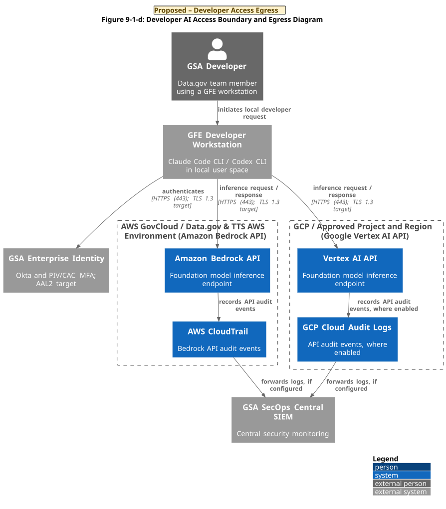

# Developer AI access: boundary and egress (Section 9 supplement)

This review draft depicts developer-initiated AI access from a GSA-furnished workstation. It does not depict application runtime traffic. Reconcile the external-service placement, identity federation, endpoint configuration, and log forwarding with the approved ATO boundary and service configuration before using this diagram as an implemented-control record.

| Flow | Proposed path | Protocol and control |
| --- | --- | --- |
| 1 | GFE to GSA identity | HTTPS port 443; PIV/CAC MFA and AAL2 target; verify TLS version and federation route |
| 2 | GFE to Bedrock or Vertex AI | Outbound HTTPS port 443; TLS 1.3 target; response returns on the same connection; verify endpoint, region, credentials, and FIPS-validated cryptography |
| 3 | Model API to provider audit service | Bedrock API events in CloudTrail; Vertex API events in Cloud Audit Logs where enabled |
| 4 | Provider audit service to GSA SecOps SIEM | Forwarding and monitoring path, where configured |



```plantuml
@startuml
!include https://raw.githubusercontent.com/plantuml-stdlib/C4-PlantUML/master/C4_Context.puml
LAYOUT_WITH_LEGEND()
title Developer AI access boundary and egress

Person_Ext(developer, "GSA Developer", "Data.gov team member using a GFE workstation")
System_Ext(gfe, "GFE Developer Workstation", "Claude Code CLI / Codex CLI in local user space")
System_Ext(idp, "GSA Enterprise Identity", "Okta and PIV/CAC MFA; AAL2 target")

Boundary(aws, "AWS GovCloud / approved AWS account") {
    System(bedrock, "Amazon Bedrock API", "Foundation model inference endpoint")
    System(cloudtrail, "AWS CloudTrail", "Bedrock API audit events")
}
Boundary(gcp, "GCP / approved project and region") {
    System(vertex, "Vertex AI API", "Foundation model inference endpoint")
    System(gcp_logs, "GCP Cloud Audit Logs", "API audit events, where enabled")
}
System_Ext(siem, "GSA SecOps Central SIEM", "Central security monitoring")

Rel(developer, gfe, "initiates local developer request")
Rel(gfe, idp, "authenticates", "HTTPS (443); TLS 1.3 target")
Rel(gfe, bedrock, "sends inference request; receives response", "HTTPS (443); TLS 1.3 target")
Rel(gfe, vertex, "sends inference request; receives response", "HTTPS (443); TLS 1.3 target")
Rel(bedrock, cloudtrail, "records API audit events")
Rel(vertex, gcp_logs, "records API audit events, where enabled")
Rel(cloudtrail, siem, "forwards logs, if configured")
Rel(gcp_logs, siem, "forwards logs, if configured")

@enduml
```
