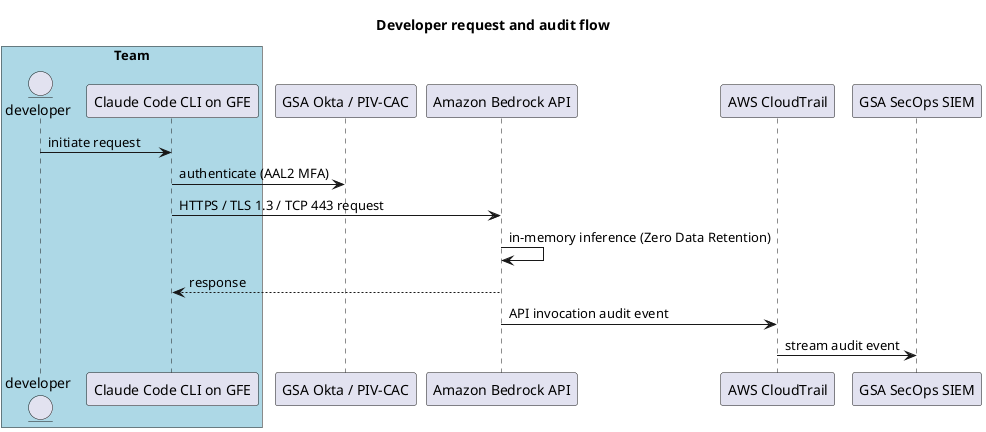
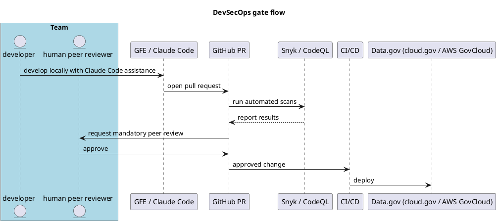

# Developer AI and DevSecOps data flows (Section 10 supplement)

Proposed flows from the request; control configuration has not been verified.

## Developer request and audit flow

## DevSecOps gate flow

