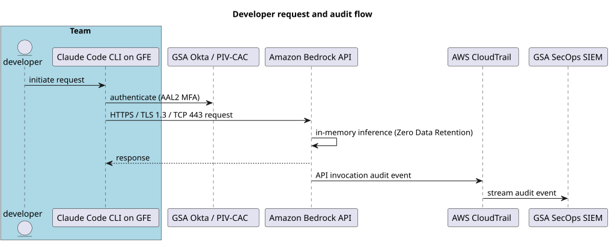
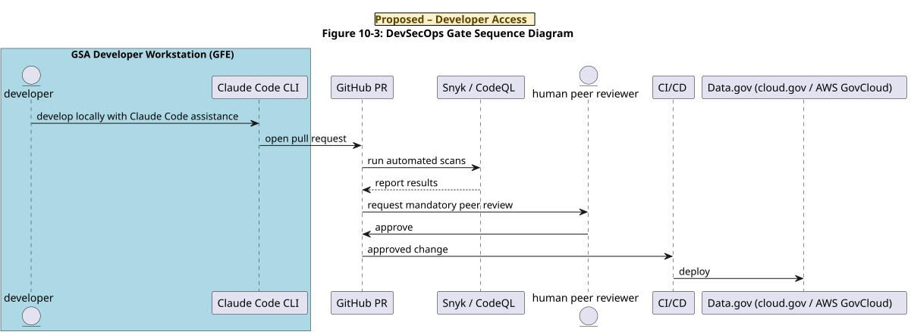

```plantuml
@startuml
title
|<#FFF2CC><color:#5B4300><b>Proposed &#8211; Developer Access</b></color>|
Figure 10-3: DevSecOps Gate Sequence Diagram
end title
box "GSA Developer Workstation (GFE)" #LightBlue
    entity "developer" as dev
    participant "Claude Code CLI" as gfe
end box
participant "GitHub PR" as pr
participant "Snyk / CodeQL" as scans
entity "human peer reviewer" as reviewer
participant "CI/CD" as cicd
participant "Data.gov (cloud.gov / AWS GovCloud)" as datagov

dev -> gfe : develop locally with Claude Code assistance
gfe -> pr : open pull request
pr -> scans : run automated scans
scans --> pr : report results
pr -> reviewer : request mandatory peer review
reviewer -> pr : approve
pr -> cicd : approved change
cicd -> datagov : deploy
@enduml
```

# Developer AI and DevSecOps data flows (Section 10 supplement)

Proposed flows from the request; control configuration has not been verified.

## Figure 10-2: Developer AI Request and Audit Sequence Diagram

**Proposed – Developer Access**

```plantuml
@startuml
title
|<#FFF2CC><color:#5B4300><b>Proposed &#8211; Developer Access</b></color>|
Figure 10-2: Developer AI Request and Audit Sequence Diagram
end title
box "GSA Developer Workstation (GFE)" #LightBlue
    entity "developer" as dev
    participant "Claude Code CLI on GFE" as cli
end box
participant "GSA Okta / PIV-CAC" as idp
participant "AWS STS" as sts
participant "Amazon Bedrock API" as bedrock
participant "AWS CloudTrail" as cloudtrail
participant "GSA SecOps SIEM" as siem

dev -> cli : initiate request
cli -> idp : authenticate (AAL2 MFA)
cli -> sts : request federated session
sts --> cli : Federated AWS STS temporary\nsession credentials
cli -> bedrock : HTTPS / TCP 443 (TLS 1.3)
bedrock -> bedrock : Model inference (Zero Data Retention\nper AWS Bedrock Enterprise Terms)
bedrock --> cli : response
bedrock -> cloudtrail : API invocation audit event
cloudtrail -> siem : Forward CloudTrail audit events\nto GSA SecOps SIEM
@enduml
```

## Figure 10-3: DevSecOps Gate Sequence Diagram

**Proposed – Developer Access**

